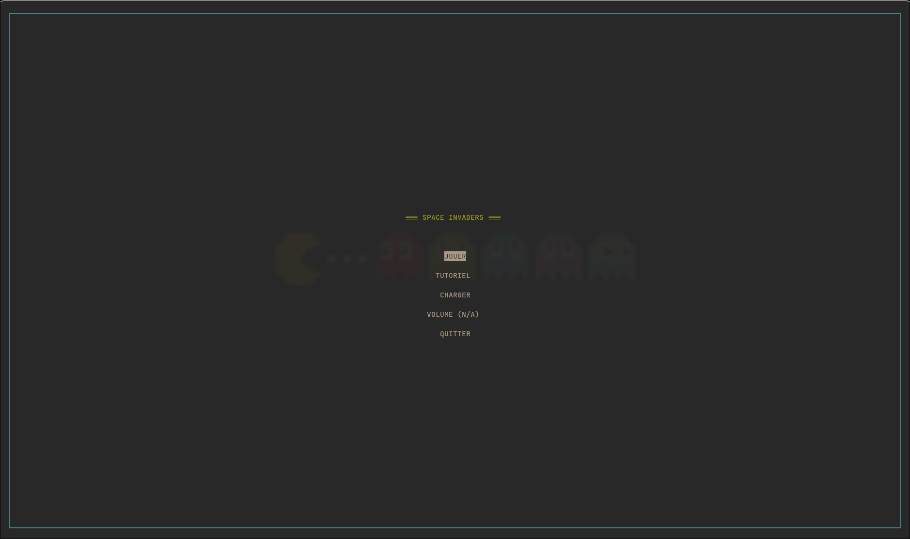
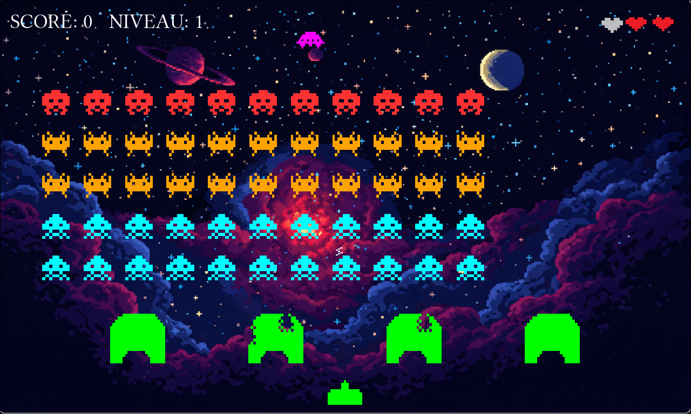
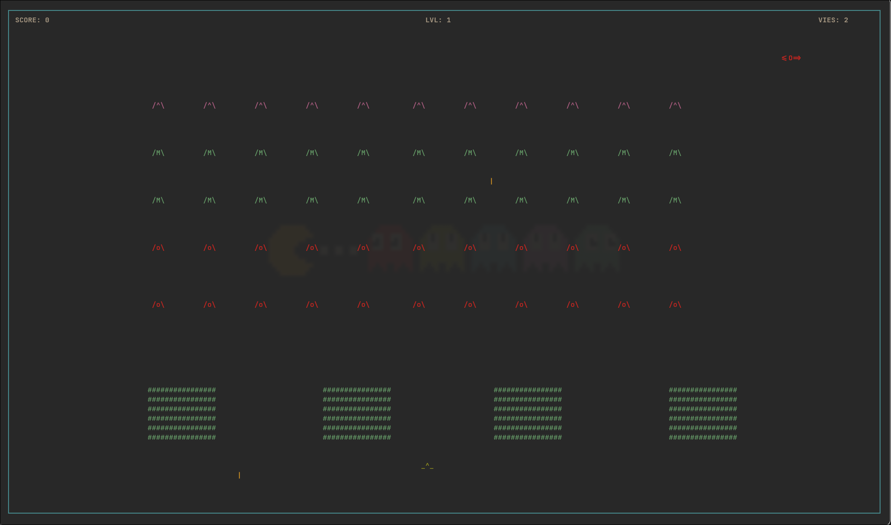

# 🚀 Space Invaders MVC

> Implémentation moderne du classique Space Invaders en C avec architecture MVC et double interface (ncurses/SDL3)


---

## 📋 Table des matières

- [Aperçu](#-aperçu)
- [Description](#-description)
- [Caractéristiques](#-caractéristiques)
- [Architecture MVC](#-architecture-mvc)
- [Prérequis](#-prérequis)
- [Installation](#-installation)
- [Compilation](#-compilation)
- [Lancement du jeu](#-lancement-du-jeu)
- [Commandes](#-commandes)
- [Structure du projet](#-structure-du-projet)
- [Système de sauvegarde](#-système-de-sauvegarde)
- [Documentation](#-documentation)
- [Dépannage](#-dépannage)
- [Licence](#-licence)

---

### 📸 Aperçu

|            Interface SDL3 (Graphique)            |              Interface ncurses (Terminal)               |
| :----------------------------------------------: | :-----------------------------------------------------: |
|  |  |
|  |  |

---

## 🎯 Description

Space Invaders MVC est une réimplémentation fidèle du jeu d'arcade classique **Space Invaders** (1978), développée en C avec une architecture **Modèle-Vue-Contrôleur** stricte.

Le projet propose **deux modes d'affichage interchangeables** :

- **SDL3** : Interface graphique moderne avec sprites, animations et effets sonores (par défaut)
- **ncurses** : Interface texte ASCII jouable directement dans le terminal

### Objectifs pédagogiques

- Démonstration d'une architecture MVC propre en C
- Séparation stricte entre logique métier et rendu graphique
- Double implémentation d'interface via polymorphisme en C
- Système de sauvegarde/chargement binaire

---

## ✨ Caractéristiques

### Gameplay

- ✅ **3 types d'ennemis** avec scores différents (10/20/30 points)
- ✅ **OVNI mystère** apparaissant aléatoirement (100 points + vie bonus)
- ✅ **4 boucliers destructibles** avec 10 états de dégradation
- ✅ **Système de vies** avec indicateur visuel (cœurs)
- ✅ **Progression par niveaux** avec augmentation de difficulté
- ✅ **Animations** : sprites alternés, explosions, tremblements d'écran
- ✅ **Rythme alien** : son accélérant avec la tension

### Technique

- 🎮 **Double interface** : SDL3 (graphique) et ncurses (terminal)
- 💾 **Système de sauvegarde** complet avec gestion de fichiers
- 🎵 **Audio SDL_mixer** : bruitages, musiques, boucles
- 🎨 **Sprites animés** : 4 frames pour projectiles, 2 pour ennemis
- ⚡ **Boucle de jeu fixe** à 60 FPS avec delta time
- 🔧 **Responsive** : Adaptation automatique à la taille de la fenêtre/terminal

---

## 🏗️ Architecture MVC

Le projet suit strictement le pattern **Modèle-Vue-Contrôleur** :

```
┌─────────────────────────────────────────────┐
│              MAIN (main.c)                  │
│         Boucle de jeu principale            │
└────────┬─────────────┬──────────────────────┘
         │             │
    ┌────▼─────┐  ┌───▼──────┐
    │ MODÈLE   │  │   VUE    │
    │(model.c) │  │(view_*.c)│
    │          │  │          │
    │ Logique  │  │  Rendu   │
    │ Métier   │  │ Graphique│
    └────▲─────┘  └───▲──────┘
         │            │
    ┌────┴────────────┴─────┐
    │    CONTRÔLEUR         │
    │   (controller.h)      │
    │  Commandes abstraites │
    └───────────────────────┘
```

### 📂 Répartition des responsabilités

#### **Modèle** (`src/model.c`)

- État du jeu (score, vies, niveau)
- Physique des entités (positions, vitesses, collisions AABB)
- Règles métier (game over, level up, spawning UFO/ennemis)
- Système de sauvegarde/chargement binaire
- **⚠️ Ne connaît PAS la vue** : aucune dépendance graphique

#### **Vue** (`src/view_ncurses.c` / `src/view_sdl.c`)

- Rendu à l'écran (sprites, textes, HUD)
- Gestion audio (bruitages, musiques)
- Capture des entrées clavier
- Conversion coordonnées logiques → pixels/caractères
- **⚠️ Ne modifie PAS le modèle** : lecture seule (sauf flags audio)

#### **Contrôleur** (`include/controller.h`)

- Définition des **commandes abstraites** (`CMD_MOVE_LEFT`, `CMD_SHOOT`, etc.)
- Interface entre périphériques bruts et logique métier

---

## 📦 Prérequis

### Dépendances système

```bash
# Ubuntu/Debian
sudo apt install build-essential cmake libncurses-dev
```

### Bibliothèques incluses (dossier 3rdParty/)

Les bibliothèques SDL3 sont fournies avec le projet :
- **SDL3** : Rendu graphique
- **SDL3_image** : Chargement d'images BMP
- **SDL3_mixer** : Gestion audio
- **SDL3_ttf** : Rendu de polices TrueType

---

## 🔧 Installation

### 1. Clonage du dépôt

```bash
git clone <url-du-repo>
cd space-invaders
```

### 2. Préparation des scripts

```bash
chmod +x build.sh clean.sh
```

---

## 🔨 Compilation

### Option recommandée : Script automatique

```bash
./build.sh
```

Ce script :
1. Compile les bibliothèques SDL3 (si nécessaire)
2. Compile le projet Space Invaders

### Nettoyage complet

```bash
./clean.sh
```

Supprime tous les fichiers compilés (bibliothèques + projet).

### Recompilation rapide (après modification du code)

```bash
make
```

---

## 🎮 Lancement du jeu

L'exécutable se trouve dans le dossier `build/` :

```bash
# Mode SDL (graphique, par défaut)
./space_invaders

# Mode ncurses (terminal)
./space_invaders --ncurses
```

**💡 Astuce SDL :** Appuyez sur **F11** pour basculer en plein écran.

**⚠️ Mode ncurses :** Taille minimale requise : 80 colonnes × 24 lignes

---

## 🕹️ Commandes

### Menu & Navigation

| Touche                  | Action                               |
| ----------------------- | ------------------------------------ |
| **↑ / ↓**               | Naviguer dans les menus              |
| **← / →**               | Ajuster le volume                    |
| **ESPACE** / **ENTRÉE** | Valider la sélection                 |
| **P** / **ÉCHAP**       | Pause / Retour                       |
| **F11**                 | Plein écran (SDL uniquement)         |

### En jeu

| Touche     | Action               |
| ---------- | -------------------- |
| **← →**    | Déplacer le vaisseau |
| **ESPACE** | Tirer                |
| **P**      | Pause                |
| **ÉCHAP**  | Menu pause           |

### Saisie de texte (sauvegarde)

| Touche        | Action                     |
| ------------- | -------------------------- |
| **A-Z / 0-9** | Caractères alphanumériques |
| **ESPACE**    | Remplacé par `_`           |
| **-**         | Tiret (autorisé)           |
| **BACKSPACE** | Effacer                    |
| **ENTRÉE**    | Valider                    |

---

## 📁 Structure du projet

```
space-invaders/
│
├── assets/                    # Ressources graphiques/audio
│   ├── aliens/               # Sprites ennemis (A1/A2/A3, UFO)
│   ├── backgrounds/          # Fonds d'écran (menu, jeu)
│   ├── explosions/           # Animations d'explosion
│   ├── fonts/                # Police TTF
│   ├── hearts/               # Icônes de vie (full/empty)
│   ├── missiles/             # Projectiles joueur (4 frames)
│   ├── projectiles/          # Projectiles ennemis (4 frames)
│   ├── shelter/              # Boucliers (10 états de dégâts)
│   ├── preview/              # Captures d'écran pour le README
│   └── audio/                # Sons (shoot, explosion, UFO, beats)
│
├── 3rdParty/                  # Bibliothèques externes (incluses)
│   ├── SDL3/                 # SDL3 principal
│   ├── SDL3_image/           # Chargement d'images
│   ├── SDL3_ttf/             # Rendu de texte TrueType
│   └── SDL3_mixer/           # Gestion audio
│
├── include/                  # Headers (.h)
│   ├── common.h             # Constantes globales (GAME_WIDTH, FPS...)
│   ├── controller.h         # Commandes abstraites (GameCommand)
│   ├── model.h              # Structures de données (GameModel, Entity...)
│   ├── utils.h              # Utilitaires (temps, aléatoire)
│   ├── view_interface.h     # Interface abstraite (ViewInterface)
│   ├── view_ncurses.h       # Implémentation ncurses
│   └── view_sdl.h           # Implémentation SDL3
│
├── src/                      # Sources (.c)
│   ├── main.c               # Point d'entrée + boucle de jeu
│   ├── model.c              # Logique métier (update, collisions, IA)
│   ├── utils.c              # Implémentation utilitaires
│   ├── view_ncurses.c       # Rendu terminal
│   └── view_sdl.c           # Rendu graphique SDL3
│
├── sauvegardes/             # Dossier des sauvegardes (.dat)
├── build/                   # Fichiers compilés (.o, exécutable)
├── docs/                    # Documentation Doxygen générée
│   ├── html/               # Documentation HTML
│   └── latex/              # Documentation LaTeX
│
├── Makefile                 # Script de compilation
├── build.sh                 # Script de build automatique
├── clean.sh                 # Script de nettoyage
├── Doxyfile                 # Configuration Doxygen
├── INSTALL.txt              # Instructions d'installation détaillées
└── README.md                # Ce fichier
```

---

## 💾 Système de sauvegarde

### Fonctionnement

Les sauvegardes sont stockées dans le dossier `sauvegardes/` au format binaire (`.dat`).

**Contenu sauvegardé :**

- Score actuel
- Nombre de vies
- Niveau en cours
- Position et état des entités (joueur, ennemis, projectiles, UFO)
- État des boucliers (tous les blocs)
- Timers et cooldowns

### Utilisation

#### Créer une sauvegarde

1. Appuyez sur **P** en jeu → Menu Pause
2. Sélectionnez **"Sauvegarder et Quitter"**
3. Choisissez **"Créer nouvelle sauvegarde"**
4. Tapez un nom (ex: `partie1`)
5. Validation → Fichier `sauvegardes/partie1.dat` créé

#### Charger une sauvegarde

1. Menu principal → **"Charger"**
2. Sélectionnez le fichier avec **↑ / ↓**
3. Validation → Le jeu reprend exactement où vous l'aviez quitté

#### Écraser une sauvegarde

- Le système détecte les noms existants et demande confirmation
- Option alternative : **"NON (dupliquer et renommer)"**

---

## 📚 Documentation

La documentation du code est générée avec **Doxygen**.

### Génération de la documentation

```bash
doxygen Doxyfile
```

### Consultation

Ouvrez `docs/html/index.html` dans votre navigateur.

---

## 🐛 Dépannage

### Problème : `SDL3 non trouvé` ou erreur de liaison

**Solution :** Utilisez le script de build automatique :

```bash
./build.sh
```

Ce script compile automatiquement toutes les bibliothèques SDL3 depuis le dossier `3rdParty/`.

### Problème : `Terminal trop petit` (ncurses)

**Cause :** La fenêtre terminal fait moins de 80×24 caractères.

**Solution :**

```bash
# Redimensionner manuellement ou forcer :
resize -s 24 80

# Ou agrandir la fenêtre du terminal
```

### Problème : `Son coupé / pas de musique` (SDL)

**Cause :** SDL_mixer non initialisé ou fichiers audio absents.

**Solution :**

```bash
# Vérifier la présence des sons
ls -l assets/audio/

# Recompiler avec logs :
make clean
make 2>&1 | grep -i "audio\|mixer"
```

### Problème : `Sprites noirs / transparence cassée`

**Cause :** Le Color Key n'est pas appliqué (SDL3).

**Solution :** Les fichiers BMP doivent avoir un fond **noir pur** (RGB 0,0,0). Le code applique automatiquement la transparence sur cette couleur.

### Problème : `Erreur de segmentation`

**Solution :**

```bash
# Compiler en mode debug et exécuter avec Valgrind
valgrind --leak-check=full ./space_invaders
```

### Problème : `Make ou GCC non trouvé`

**Solution :**

```bash
# Ubuntu/Debian
sudo apt install build-essential cmake

# Fedora
sudo dnf groupinstall "Development Tools" && sudo dnf install cmake
```

---

## 📜 Licence

Ce projet est sous licence **MIT**. Voir le fichier [LICENSE](LICENSE) pour plus de détails.

```
MIT License

Copyright (c) 2024-2025 Chamseddine Adaadour & Quentin Pellosse

Permission is hereby granted, free of charge, to any person obtaining a copy
of this software and associated documentation files (the "Software"), to deal
in the Software without restriction, including without limitation the rights
to use, copy, modify, merge, publish, distribute, sublicense, and/or sell
copies of the Software, and to permit persons to whom the Software is
furnished to do so, subject to the following conditions:

The above copyright notice and this permission notice shall be included in all
copies or substantial portions of the Software.

THE SOFTWARE IS PROVIDED "AS IS", WITHOUT WARRANTY OF ANY KIND, EXPRESS OR
IMPLIED, INCLUDING BUT NOT LIMITED TO THE WARRANTIES OF MERCHANTABILITY,
FITNESS FOR A PARTICULAR PURPOSE AND NONINFRINGEMENT. IN NO EVENT SHALL THE
AUTHORS OR COPYRIGHT HOLDERS BE LIABLE FOR ANY CLAIM, DAMAGES OR OTHER
LIABILITY, WHETHER IN AN ACTION OF CONTRACT, TORT OR OTHERWISE, ARISING FROM,
OUT OF OR IN CONNECTION WITH THE SOFTWARE OR THE USE OR OTHER DEALINGS IN THE
SOFTWARE.
```

---

## 👤 Auteurs

**Chamseddine Adaadour & Quentin Pellosse**

- 🌐 GitHub : [@Dwikso](https://github.com/Dwikso) & [@chamse22ine](https://github.com/chamse22ine)

---

## 🎓 Remerciements

- **Tomohiro Nishikado** - Créateur original de Space Invaders (1978)
- **SDL Team** - Bibliothèque SDL3
- **Communauté ncurses** - Gestion terminal

---

## 📚 Ressources

### Documentation technique

- [SDL3 Wiki](https://wiki.libsdl.org/SDL3/FrontPage)
- [Ncurses HOWTO](https://tldp.org/HOWTO/NCURSES-Programming-HOWTO/)
- [Architecture MVC en C](https://en.wikipedia.org/wiki/Model%E2%80%93view%E2%80%93controller)

### Tutoriels Space Invaders

- [Guide Gameplay Original](https://en.wikipedia.org/wiki/Space_Invaders)
- [Analyse Technique (Patterns)](https://www.gamedeveloper.com/design/space-invaders-design-patterns)
